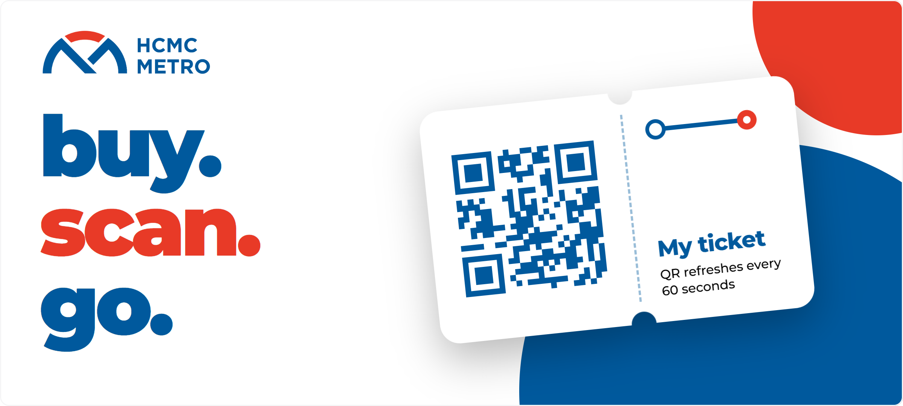
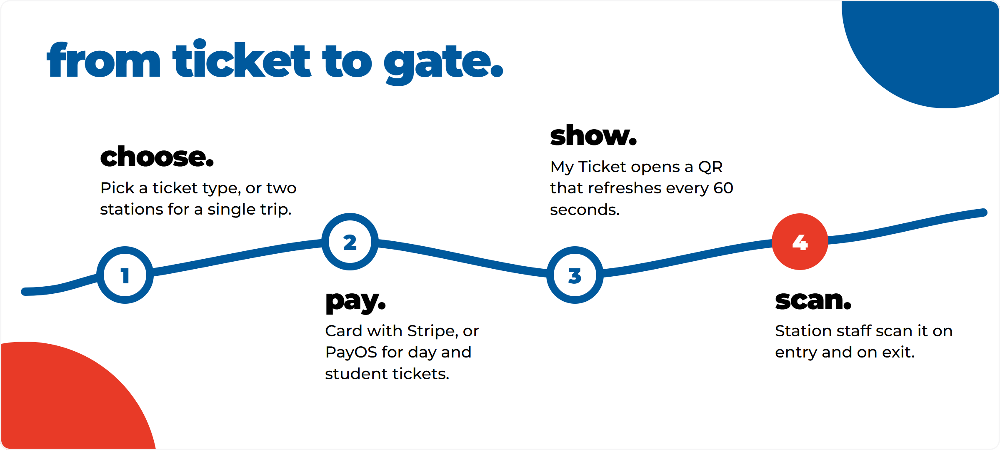
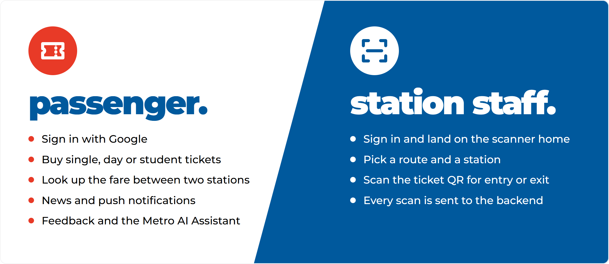
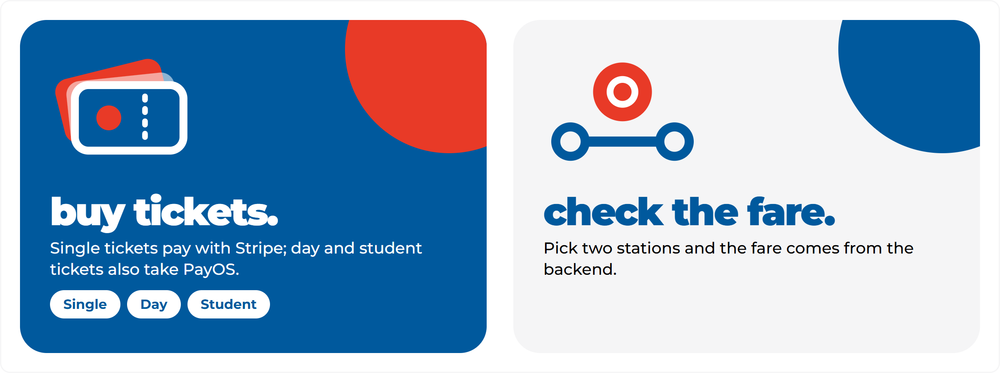
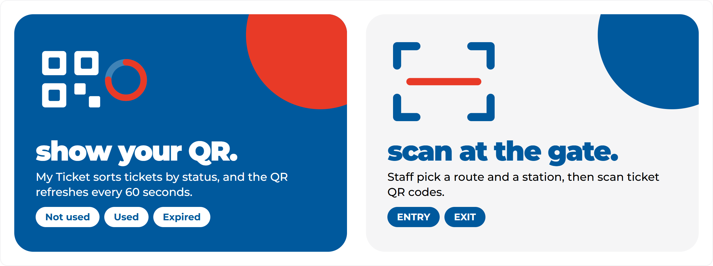
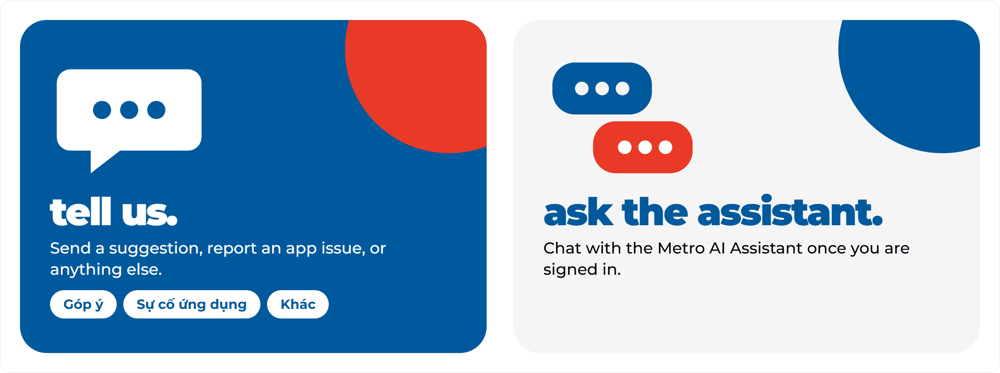
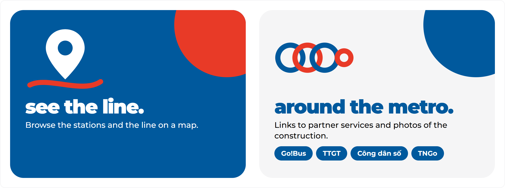
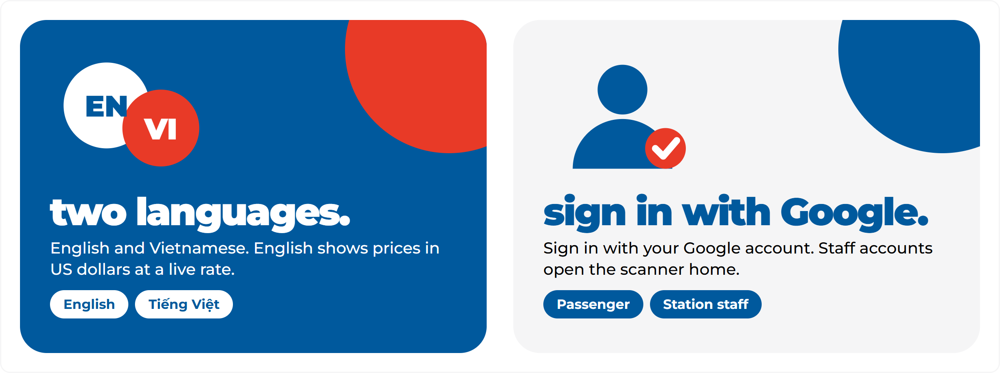
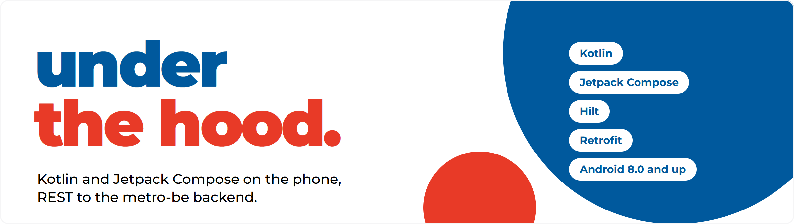
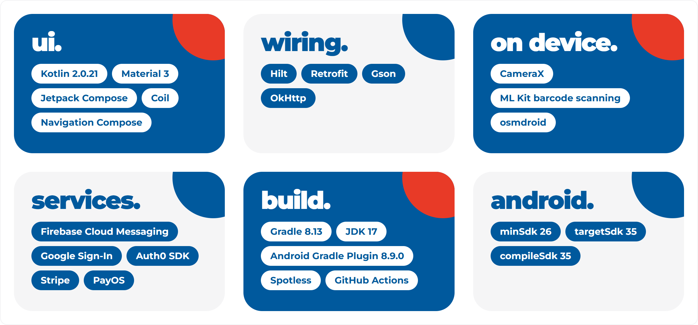

<h1 align="center"><picture><source media="(prefers-color-scheme: dark)" srcset="assets/hero-dark.webp"></picture></h1>

**Buy a ticket, show a QR code, walk through the gate. The HCMC Metro app does it from your phone, and the same app lets station staff scan tickets at the gate.**

HCMC Metro is an Android app for riding the Ho Chi Minh City metro. Passengers sign in with Google, choose a ticket, pay online and keep a QR code ready in My Ticket. Station staff sign in to the same app and land on a scanner. Around the ticket sit the small things that make a trip easier: a fare check between two stations, news, push notifications, feedback, an AI assistant, a map, and English and Vietnamese.

## From ticket to gate

<picture><source media="(prefers-color-scheme: dark)" srcset="assets/journey-dark.webp"></picture>

## One app, two roles

<picture><source media="(prefers-color-scheme: dark)" srcset="assets/roles-dark.webp"></picture>

## Everything in the app

### Tickets and fares

<picture><source media="(prefers-color-scheme: dark)" srcset="assets/features-tickets-dark.webp"></picture>

### At the gate

<picture><source media="(prefers-color-scheme: dark)" srcset="assets/features-gate-dark.webp"></picture>

### News and alerts

<picture><source media="(prefers-color-scheme: dark)" srcset="assets/features-news-dark.webp"></picture>

### Talk to us

<picture><source media="(prefers-color-scheme: dark)" srcset="assets/features-voice-dark.webp"></picture>

### Around the metro

<picture><source media="(prefers-color-scheme: dark)" srcset="assets/features-around-dark.webp"></picture>

### Account and language

<picture><source media="(prefers-color-scheme: dark)" srcset="assets/features-account-dark.webp"></picture>

## Under the hood

<picture><source media="(prefers-color-scheme: dark)" srcset="assets/tech-hero-dark.webp"></picture>

The app is a Kotlin and Jetpack Compose client of the REST backend in [metro-be](https://github.com/hcmurs/metro-be). This part shows how the pieces fit together, what the app is built with, and how to run it and ship a change.

### How it fits together

<picture><source media="(prefers-color-scheme: dark)" srcset="assets/tech-flow-dark.webp"></picture>

Screens call repositories, repositories call the backend through Retrofit and OkHttp, and Hilt injects each layer. Every request goes to `base.url`. Google sign-in, card payment, push messages and map tiles reach the phone from their own services, and the PayOS checkout opens in a browser.

<details>
<summary><b>API paths the app calls</b></summary>

- Sign-in: `auth/oauth2/google`, `auth/profile`
- Tickets: `ts/ticket-types`, `ts/tickets/qr`, `ts/tickets/code/{code}`, `ts/tickets/scan/entry`, `ts/tickets/scan/exit`
- Fares: `ts/fare-matrices`, `ts/fare-matrices/get-fare`
- Orders and payment: `orders/create/single`, `orders/create/days`, `orders/user`, `payment/stripe/*`, `payment/payos/*`
- Stations and routes: `stations`, `routes`, `station-routes/route/{id}`
- News, feedback, assistant, notifications: `users/blogs`, `users/feedbacks`, `users/chatbot/chat`, `notifications/*`, `user-device-tokens`

</details>

### Built with

<picture><source media="(prefers-color-scheme: dark)" srcset="assets/tech-stack-dark.webp"></picture>

### Run it and ship a change

<picture><source media="(prefers-color-scheme: dark)" srcset="assets/tech-workflow-dark.webp"></picture>

**What you need**

- Android Studio that opens an Android Gradle Plugin 8.9.0 project, and JDK 17 (the version the CI workflow uses).
- Android SDK platform 35 (the project compiles and targets 35).
- A device or emulator running Android 8.0 (API 26) or later.
- A `google-services.json` from your own Firebase project, saved as `app/google-services.json`. The file is not in the repository and git ignores it; the Google services plugin is applied, so the build expects it.
- A running backend that the app can reach, see [metro-be](https://github.com/hcmurs/metro-be).

**Clone and build**

```bash
git clone https://github.com/hcmurs/metro-app.git
cd metro-app
cp local.properties.sample local.properties
```

Fill in `local.properties` as described under Configuration, then build a debug APK:

```bash
./gradlew assembleDebug
```

On Windows use `gradlew.bat assembleDebug`. You can also open the folder in Android Studio, wait for the Gradle sync and press Run on a device or emulator.

**Configuration**

The build reads four keys from `local.properties` (the file is git-ignored). A missing file or a missing key stops the build with an error.

| Key | What it is |
|---|---|
| `sdk.dir` | Path to your Android SDK, for local builds |
| `auth0.domain` | Domain of the Auth0 tenant used by the Auth0 login |
| `auth0.client.id` | Client ID of the Auth0 application |
| `base.url` | Root URL of the backend API; end it with a slash |

`local.properties.sample` lists `sdk.dir`, `auth0.domain` and `auth0.client.id`; add `base.url` yourself. Pass the values through your own secret store in CI; never commit them. From an Android emulator the host machine is `10.0.2.2`, and cleartext HTTP is allowed only for the addresses listed in `app/src/main/res/xml/network_security_config.xml`.

**Ship a change**

1. Fork the repository and create a branch from `develop`.
2. Run `./gradlew spotlessApply` and commit your change. Kotlin is formatted with Spotless (ktlint), and every source file carries the license header from `spotless/license-header.kt`.
3. Push the branch and open a pull request to `develop`. A GitHub Actions workflow runs `spotlessCheck` on pull requests to `develop` and `main`; run it yourself with `./gradlew spotlessCheck`.

### Code layout

```
app/src/main/java/org/com/hcmurs/
├── core/            # api, common, config, constant, di (Hilt modules)
├── model/           # data models
├── oauth/           # Google sign-in
├── repositories/    # Retrofit APIs and repositories
├── security/        # token handling
├── ui/
│   ├── components/
│   ├── screens/     # login, metro (home, tickets, maps, ...), news, notification, scanqr, staffhome, stationselection
│   └── theme/
├── utils/
├── FCMService.kt    # push messages
├── MainActivity.kt
└── Navigation.kt    # every route in one place
```

<details>
<summary><b>Design tokens</b></summary>

Colours, type, shapes and the rules for the illustrations in this README are in [assets/frontdoor.md](assets/frontdoor.md).

</details>

## Contact

- Organization: [HCMURS](https://github.com/hcmurs)
- Repository: [metro-app](https://github.com/hcmurs/metro-app)
